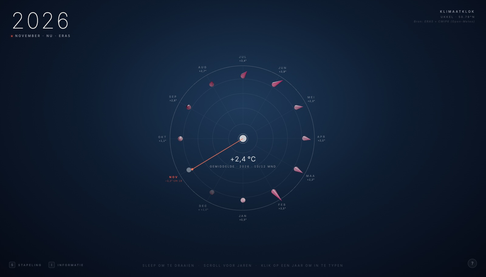

# Klimaatklok

Monthly temperature anomalies for Uccle (Ukkel), Belgium, drawn as a ring of clocks: one clock per year from 2015 to 2040, one cone per month. A cone pointing outward means warmer than the 1991–2020 normal.

**Live:** https://gulpembecolak-dev.github.io/klimaatklok/



## What it shows

Every month on every clock has one of three states:

- **Measured:** a complete month from ERA5 reanalysis via the [Open-Meteo Archive API](https://open-meteo.com/en/docs/historical-weather-api).
- **Running:** the current month up to yesterday, fetched live by the browser and marked as provisional (`−0,3° t/m 19`).
- **Projected:** any month that hasn't happened yet, taken from one CMIP6 HighResMIP model run (EC-Earth3P-HR) via the [Open-Meteo Climate API](https://open-meteo.com/en/docs/climate-api). In the current year these are drawn faint and marked `≈`. A single model run gives a plausible path, not a forecast for a specific month.

The anomaly is the monthly mean minus the KMI normal for 1991–2020. Each month label carries its value in small type.

## How it stays current

1. **Monthly.** On the 3rd of every month a GitHub Action (`.github/workflows/update-data.yml`) runs `scripts/update-data.mjs`. The script rewrites `data/klimaat.json` with every complete measured month plus the projection, and commits only when something changed. GitHub Pages then redeploys.
2. **Live.** On load, `data.js` fetches the JSON with `cache: 'no-cache'`, so visitors never see an old copy. It also asks Open-Meteo for every day after the last month in the JSON. That fills the running month, and it also fills last month during the first days of a new month, before the Action has run.
3. **New year.** On 1 January the hand moves to the new year's clock. Its months start out as projections and turn into measurements one by one. The previous year's December is completed live and saved to the JSON on 3 January.

To test another date, add `?nu=2027-01-02` to the URL.

To run the update by hand:

```sh
node scripts/update-data.mjs
```

The script needs Node 18 or newer and has no dependencies.

## Stack

Plain HTML, CSS and JavaScript with [Three.js](https://threejs.org) loaded through an import map. There is no build step. Any static server works:

```sh
python3 -m http.server
```

## Controls

- Drag to rotate.
- Scroll to move between years.
- Click a year to type one in.
- Click a month for its detail page.
- `S` stacks all the years.
- `I` opens background information.
